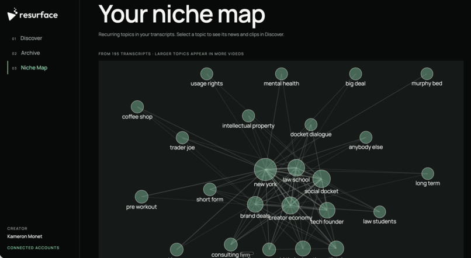
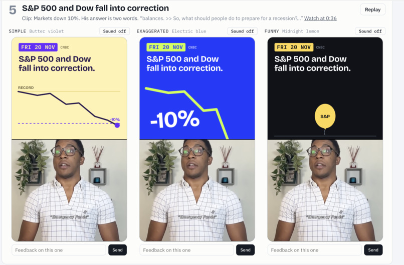

# Resurface

Resurface finds the old clips that are worth reposting **today**.

<video src="./public/demo/readme/resurface-walkthrough.mp4?raw=true" controls preload="metadata" width="720"></video>

[Watch the walkthrough if the player doesn’t load](./public/demo/readme/resurface-walkthrough.mp4?raw=true)

[Try Resurface](https://resurface-nyc.vercel.app/) or [open the demo reels](https://resurface-nyc.vercel.app/?demo).

## Inspiration

Creators have libraries of old content that no longer gets surfaced. But trends and news can make some clips more relevant today than when they were originally posted.

We also love the ADHD-friendly split screens on TikTok. We use the top half to show what happened today and the bottom half to play the original clip.

## What it does

Add a creator by name and give us one public social link. You.com finds other accounts for you to confirm. We use Treg to pull the creator’s back catalog, up to 100 recent posts per format in this build: YouTube videos, YouTube Shorts, Instagram Reels, and TikTok videos.

We create a content graph that picks out topics, subjects, and phrases the creator talked about. You.com searches for news and trends that match those topics. In Discover, you can read the source and jump to the exact moment in the old video.

Each reel adds a motion graphic that connects today’s news to an old clip. The prebuilt demo reels show three takes: simple, exaggerated, and funny.

The goal is five new videos each day. The creator spends about 25 seconds choosing which clips to post. Daily delivery and one-click posting aren’t built yet.

## How we built it

Treg and You.com are essential to how it works. Treg pulls videos and timestamped transcripts. You.com finds social accounts and tracks what’s happening now. Claude helped score which clips to use and make motion graphics for the demo. The render scripts put the graphic above the original clip and export a vertical MP4.

The web app lives at the repo root. The [Electron transcript archive](./electron/) is separate. See the [render pipeline](./pipeline/README.md), [Claude skill](./skill/news-hook-clip-matcher/SKILL.md), and [Kameron Monet example](./examples/kameron-monet/).

## Challenges we ran into

Getting the content downloaded was hard until we found Treg. We still had to handle missing captions and keep the timestamps so every match could take you to the right moment.

## Accomplishments that we’re proud of

You can literally add a creator and it works. It finds interesting repost opportunities for evergreen topics. In the demo, a market correction makes an old Jahbari Taylor clip about preparing for a recession relevant again.

Most clipping services ask, “What are the best bits of this video to clip?” We ask, “Which clips from your whole archive are best **today**?”

